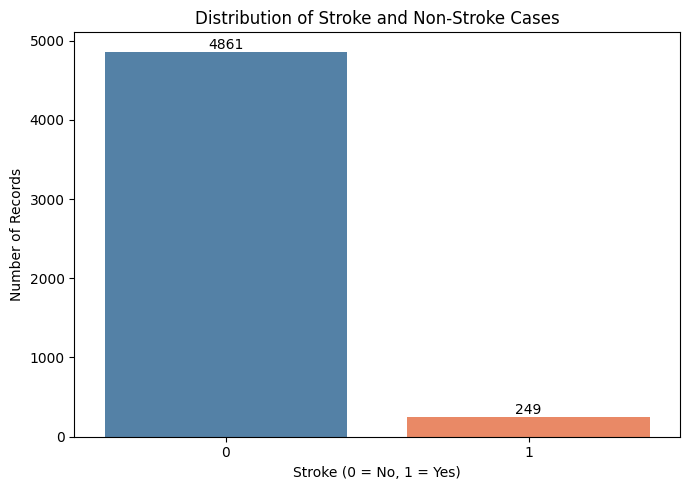
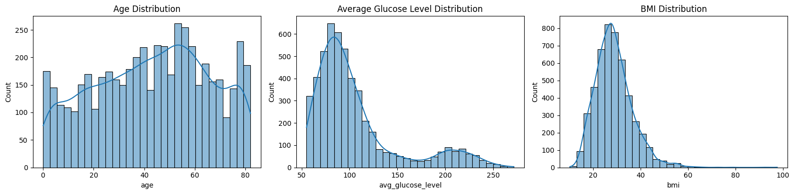
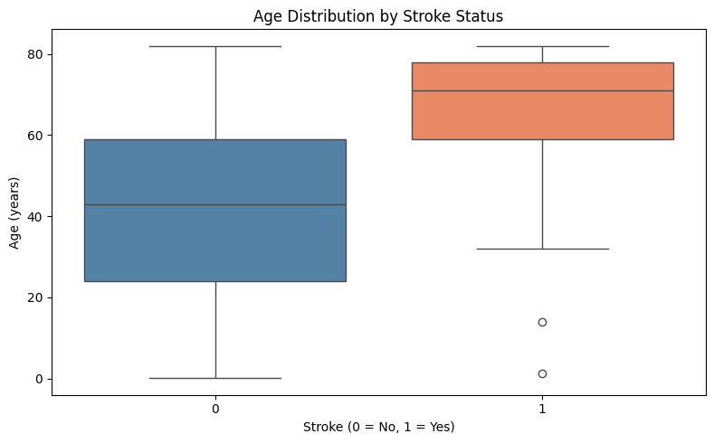
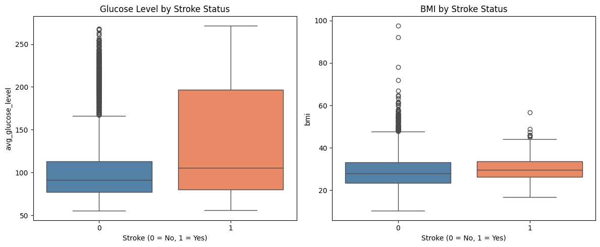
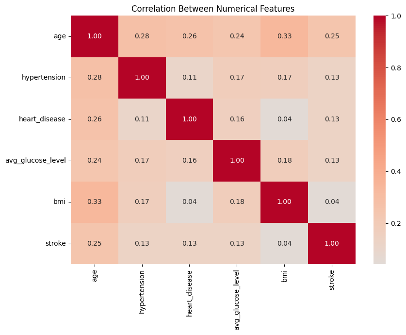

# Early Stroke Risk Prediction Using Machine Learning and Class Rebalancing

## Project Overview

Stroke is a serious medical condition that can lead to
long-term disability and life-threatening complications.

This project explores the use of machine learning to
identify stroke-associated patterns using demographic,
medical and lifestyle-related features.

The project focuses on handling class imbalance,
comparing classification algorithms and improving
the detection of stroke-positive records.

## Sustainable Development Goal

SDG 3 - Good Health and Well-Being

## Project Objectives

- Perform exploratory data analysis.
- Identify important stroke-associated features.
- Handle missing values and categorical variables.
- Address class imbalance using SMOTE and SMOTENC.
- Compare Random Forest and XGBoost classifiers.
- Improve recall using decision threshold analysis.
- Develop an interactive web application.
- Deploy the trained machine learning model.

## Dataset

Dataset: Stroke Prediction Dataset

Source:
[Kaggle Dataset](https://www.kaggle.com/datasets/fedesoriano/stroke-prediction-dataset)

| Property | Details |
|---|---|
| Total Records | 5,110 |
| Original Columns | 12 |
| Input Features | 10 |
| Target Variable | stroke |
| Missing BMI Values | 201 |
| Duplicate Records | 0 |
| Non-Stroke Records | 4,861 |
| Stroke Records | 249 |

The dataset is highly imbalanced, with approximately
4.87% stroke-positive records and 95.13% non-stroke records.

## Input Features

| Feature | Description |
|---|---|
| gender | Gender of the individual |
| age | Age of the individual |
| hypertension | Presence of hypertension |
| heart_disease | Presence of heart disease |
| ever_married | Marital status |
| work_type | Employment category |
| Residence_type | Urban or rural residence |
| avg_glucose_level | Average glucose level |
| bmi | Body Mass Index |
| smoking_status | Smoking history |

## Project Methodology

1. Dataset collection and inspection
2. Exploratory data analysis
3. Missing-value handling
4. Feature encoding and standardization
5. Training, validation and testing split
6. Baseline model training
7. Class rebalancing using SMOTE and SMOTENC
8. Model comparison
9. Decision threshold selection
10. Final model evaluation
11. Feature importance analysis
12. Model serialization
13. Web application integration

## Exploratory Data Analysis

### Stroke Class Distribution



### Age Distribution



### Age Distribution by Stroke Status



### Glucose Level Distribution



### Correlation Heatmap



## Data Preprocessing

The following preprocessing techniques were implemented:

- Removal of the unnecessary ID column.
- Median imputation for missing numerical values.
- Most frequent imputation for categorical values.
- One-hot encoding for categorical features.
- Standardization of numerical features.
- Stratified dataset splitting.

### Dataset Split

| Dataset | Percentage | Records |
|---|---:|---:|
| Training | 60% | 3,066 |
| Validation | 20% | 1,022 |
| Testing | 20% | 1,022 |

Preprocessing parameters are learned from training data.

Class rebalancing is applied only to training data.

## Machine Learning Algorithms

### Random Forest

Random Forest is an ensemble learning algorithm
that combines multiple decision trees to perform
classification.

### XGBoost

XGBoost is a gradient boosting algorithm that
builds decision trees sequentially to improve
prediction performance.

## Class Rebalancing Techniques

### SMOTE

Synthetic Minority Oversampling Technique generates
synthetic minority-class samples to reduce
class imbalance.

### SMOTENC

SMOTENC is a variation of SMOTE designed for
datasets containing both numerical and
categorical features.

## Model Comparison

Five model configurations were evaluated using
validation data.

| Model | Recall | F1-Score | ROC-AUC |
|---|---:|---:|---:|
| Random Forest | 0.00 | 0.0000 | 0.7959 |
| XGBoost | 0.04 | 0.0769 | 0.8503 |
| Random Forest + SMOTE | 0.04 | 0.0563 | 0.7877 |
| XGBoost + SMOTE | 0.24 | 0.1860 | 0.8082 |
| XGBoost + SMOTENC | 0.54 | 0.2318 | 0.7990 |

These results were obtained before decision
threshold optimization.

## Final Model Selection

XGBoost without resampling was selected because
it achieved the highest validation ROC-AUC.

Although class rebalancing improved recall at
the default classification threshold, it did not
produce the highest ROC-AUC in this experiment.

Decision threshold analysis was subsequently
performed to improve stroke-class detection.

- Selected Algorithm: XGBoost
- Resampling: None
- Decision Threshold: 0.05

The selected threshold is an experimental
classification cutoff, not a clinical cutoff.

## Final Model Performance

| Evaluation Metric | Score |
|---|---:|
| Accuracy | 77.89% |
| Precision | 15.63% |
| Recall | 80.00% |
| F1-Score | 0.2614 |
| ROC-AUC | 0.8469 |

## Confusion Matrix

| Actual / Predicted | No Stroke | Stroke |
|---|---:|---:|
| No Stroke | 756 | 216 |
| Stroke | 10 | 40 |

- True Negatives: 756
- False Positives: 216
- False Negatives: 10
- True Positives: 40
- Correct Predictions: 796
- Incorrect Predictions: 226

The model correctly identified 40 out of 50
stroke-positive records in the test dataset.

## Milestone 2 vs Final Implementation

| Metric | Milestone 2 | Final Model |
|---|---:|---:|
| Accuracy | 75.73% | 77.89% |
| Precision | 13.33% | 15.63% |
| Recall | 72.00% | 80.00% |
| F1-Score | 0.2250 | 0.2614 |
| ROC-AUC | 0.8122 | 0.8469 |

The final implementation achieved improved recorded
performance across all five evaluation metrics.

## Technologies Used

### Programming Language

- Python

### Libraries

- NumPy
- Pandas
- Matplotlib
- Seaborn
- Scikit-learn
- Imbalanced-learn
- XGBoost
- Joblib

### Development Tools

- Google Colab
- Jupyter Notebook
- GitHub

### Planned Web Application

- Streamlit
- HTML and CSS
- Streamlit Community Cloud

## Repository Structure

```text
Early-Stroke-Risk-Prediction/
│
├── assets/
│   ├── EDA visualizations
│   └── Model evaluation visualizations
│
├── data/
│   └── README.md
│
├── notebooks/
│   ├── README.md
│   ├── Stroke_Risk_Prediction_Milestone_2.ipynb
│   └── Stroke_Risk_Prediction_Final.ipynb
│
├── models/
│   ├── README.md
│   ├── model.pkl
│   ├── preprocessor.pkl
│   ├── threshold.pkl
│   └── model_name.pkl
│
├── reports/
│
├── .gitignore
└── README.md
```

## How to Run the Machine Learning Notebook

1. Clone or download this repository.
2. Download the dataset from the Kaggle link.
3. Open the final notebook in Google Colab.
4. Install the required libraries.
5. Upload the dataset when prompted.
6. Execute all notebook cells sequentially.
7. Review the model evaluation results.
8. Download the generated model artifacts.

## Trained Model Artifacts

| File | Purpose |
|---|---|
| model.pkl | Trained XGBoost classifier |
| preprocessor.pkl | Fitted preprocessing pipeline |
| threshold.pkl | Selected classification threshold |
| model_name.pkl | Selected model name |

These artifacts allow the web application to
generate predictions without retraining the model.

## Web Application

The planned Streamlit application will include:

- Home page
- Interactive prediction form
- Dataset and EDA dashboard
- Model performance dashboard
- Feature importance analysis
- Project methodology
- About the project

Deployment Status: Under Development

## Project Progress

- [x] Dataset collection
- [x] Exploratory data analysis
- [x] Data preprocessing
- [x] Baseline model training
- [x] SMOTE implementation
- [x] SMOTENC implementation
- [x] Model comparison
- [x] Decision threshold analysis
- [x] Final model evaluation
- [x] Feature importance analysis
- [x] Model serialization
- [x] GitHub repository setup
- [ ] Web application development
- [ ] Model integration
- [ ] Application testing
- [ ] Public deployment

## Limitations

- The dataset contains relatively few stroke-positive records.
- The model has limited precision and produces false positives.
- Standard SMOTE can generate fractional values for
  one-hot encoded categorical features.
- The selected threshold is based on experimental
  validation results.
- The test split was previously examined during
  Milestone 2, limiting independent evaluation.
- The model has not been externally or clinically validated.
- Model scores should not be interpreted as calibrated
  probabilities of future stroke.
- Feature importance does not establish causation.

## Future Scope

- Evaluation using larger and more diverse datasets.
- External validation of model performance.
- Improvement of precision and recall.
- Investigation of probability calibration.
- Interactive machine learning dashboards.
- Deployment of an accessible educational web application.

## Disclaimer

This project is developed for academic and educational
purposes only.

The machine learning model is not a medical diagnostic
tool and should not be used for clinical decisions.

## Conclusion

This project demonstrates the application of machine
learning and class-rebalancing techniques to an
imbalanced healthcare dataset.

The experimental results highlight the importance of
comparing multiple models, selecting appropriate
evaluation metrics and optimizing the decision threshold.

The final model achieved a recall of 80% and a ROC-AUC
of 0.8469 on the available test dataset.
